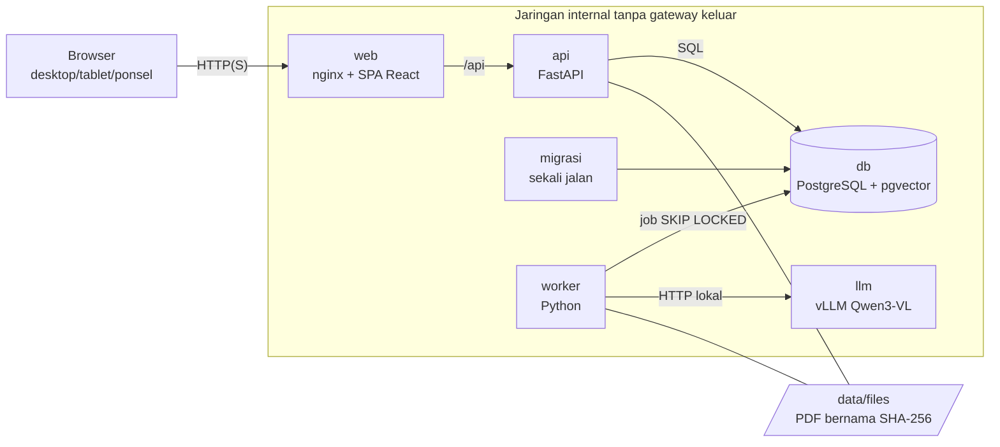
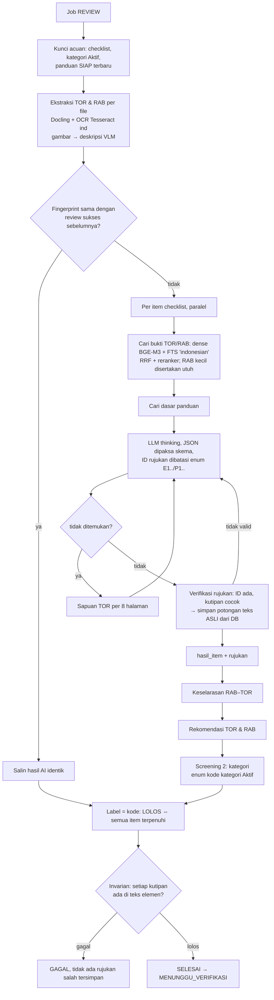

# Arsitektur

Ringkasan teknis. Alasan pemilihan teknologi ada di [desain.md](../desain.md); penyimpangan dari desain dicatat di desain.md §7.

## Diagram komponen

| Layanan | Isi | Skenario |
| --- | --- | --- |
| `web` | nginx + build React (prod) / Vite hot reload (dev). CSP `default-src 'self'`. | semua |
| `api` | FastAPI, 4 proses uvicorn: auth, RBAC, CRUD, unduhan berizin | semua |
| `migrasi` | Membuat/memperbarui skema + seed, lalu selesai | semua |
| `worker` | Antrean job: ekstraksi PDF, embedding, pipeline review | dev, tiruan, node AI |
| `llm` | vLLM (OpenAI-compatible) melayani model VLM *thinking* | dev, node AI |
| `db` | PostgreSQL 17 + pgvector: data, vektor, full-text, antrean, audit | semua |

Node AI di GPU sewaan menjalankan `worker` + `llm` saja ([docker-compose.node-ai.yml](../docker-compose.node-ai.yml)). Node ini terhubung ke database instansi lewat WireGuard dan mengambil PDF lewat `/api/internal/file/{sha}` ke tmpfs.

## Alur data

1. Pengusul mengunggah TOR + RAB. API memvalidasi PDF (magic bytes, dapat dibuka, tidak terenkripsi, ≤100 MB), lalu menyimpannya sebagai `files/ab/cd/<sha256>.pdf`.
2. Saat "Ajukan Review", `revisi.status` berubah menjadi `ANTRE`. Baris `review` (dengan `trace_id`) dan `job` dibuat.
3. Worker mengambil job FIFO dan mengunci versi checklist, kategori Aktif, dan panduan. Status menjadi `DIPROSES_AI`.
4. Hasil per item disimpan bertahap. Setelah invarian rujukan lolos, status menjadi `MENUNGGU_VERIFIKASI`.
5. Reviewer membuat override (tabel terpisah) lalu memfinalkan. Snapshot `label_final` / `kategori_final_id` disimpan, dan status menjadi `LOLOS`/`TIDAK_LOLOS`.
6. Revisi baru (TOR dan/atau RAB) membuat `revisi` baru; dokumen yang tidak diganti menunjuk file lama.

## Alur pipeline AI

### Mengapa rujukan dijamin benar (E3)

- Ekstraksi menghasilkan **elemen** (paragraf, butir, sel tabel, gambar) dengan halaman = indeks halaman PDF, `bbox`, dan `label_lokasi` (mis. "Bab II › poin 2.3 › paragraf 2", "Pasal 5 ayat (2)", "Tabel 1, baris 3, kolom “Volume”").
- LLM hanya menerima alias `E1`, `P1`, … dan hanya boleh menjawab alias tersebut (enum JSON schema).
- Kode mencocokkan kutipan dengan teks elemen setelah normalisasi. Yang disimpan adalah **potongan asli dari database**. Halaman, lokasi, dan bbox selalu dibaca dari tabel `elemen`.
- Rujukan yang tidak cocok dibuang dan item dinilai ulang (maks. 2×). Item "terpenuhi" tanpa bukti sah diubah menjadi tidak terpenuhi.
- Sebelum hasil disimpan, `periksa_invarian` memastikan setiap `rujukan.kutipan` adalah substring teks elemennya. Jika tidak, review GAGAL.

### Konsistensi hasil

Lapis 1: temperatur 0, seed tetap, konteks diurutkan stabil, prompt berversi (`PROMPT_VERSI`).
Lapis 2: `fingerprint = sha256(SHA TOR, SHA RAB, versi checklist, isi kategori review, versi panduan, model, prompt, embedding, reranker, ekstraktor)`. Fingerprint yang sama berarti hasil disalin (`review.disalin_dari_id`).

## Database

Tabel dan kegunaannya mengikuti desain.md §3. Ringkasannya:

- **Berversi & tidak berubah**: `checklist_item` + `checklist_histori`, `kategori` + `kategori_histori`, `panduan` + `panduan_histori` (isi terbaru + riwayat). Perubahan selalu berupa baris versi baru; review menyimpan salinan kategori Aktif di `review_kategori` serta salinan panduan + nomor versinya di `review_panduan`.
- **Ekstraksi per file**: `file` (unik per SHA) → `halaman`, `elemen`, `chunk` (pgvector 1024 dim + kolom `tsv` hasil `to_tsvector('indonesian')`).
- **Review**: `review` (acuan, fingerprint, model_info, progres, label_ai, snapshot final), `hasil_item`, `hasil_kategori`, `rekomendasi`, `rujukan` (hanya `elemen_id` + kutipan), `override` (terpisah, dapat dibatalkan), `catatan_reviewer`, `review_panduan`.
- **Operasional**: `job` (antrean), `node_ai` (detak & token node), `audit_log` (hanya tambah), `sesi`.

Nilai final dihitung oleh satu fungsi, `app/nilai_final.py::hitung_nilai_final`.

## Antrean & kapasitas

- `SELECT … FOR UPDATE SKIP LOCKED` memungkinkan banyak worker (banyak node GPU) berbagi antrean tanpa koordinator.
- Worker mengirim detak tiap 20 detik (`node_ai.terakhir_terlihat`, `job.dikunci_at`). Job tanpa detak >5 menit dikembalikan ke antrean dan dilanjutkan dari item terakhir yang tersimpan. Setelah 3 percobaan, job dianggap GAGAL.
- Bila tidak ada node aktif, Pengusul melihat status "Menunggu kapasitas AI".

## Logging

- Log JSON per baris ditulis ke `data/logs/{api,worker,migrasi}.log` dengan rotasi 50 MB × 10.
- Field log: `waktu`, `level`, `modul`, `pesan`, `trace_id`, `pengguna_id`, `usulan_id`, `revisi_id`, `review_id`, `job_id`, `durasi_ms`, `tahap`.
- Setiap review memiliki `trace_id` yang muncul dari pengajuan, ekstraksi, setiap panggilan LLM, hingga penyimpanan. Telusuri dengan: `grep <trace_id> data/logs/worker.log`.
- Log tidak memuat password, token, atau isi dokumen; yang dicatat hanya ID dan panjang. Audit aktivitas pengguna disimpan terpisah di tabel `audit_log`.
